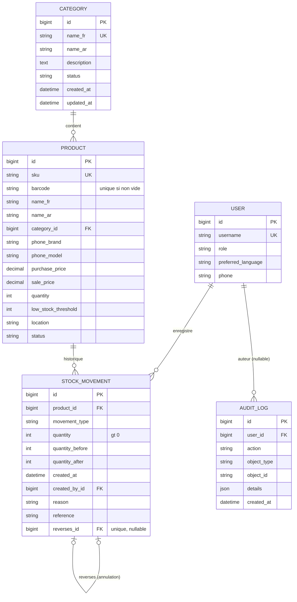

# Modèle de données — lot 1

## Règles
- `Product.quantity` n'est modifié que par `inventory.services.record_movement` (transaction + verrou de ligne `select_for_update`).
- `StockMovement` et `AuditLog` sont en ajout seul. Une correction crée un mouvement inverse relié par `reverses`.
- Suppressions : `PROTECT` sur catégorie, produit et utilisateur de mouvement. On archive (`status=archived`), on ne supprime pas.
- Contraintes SQL : prix >= 0, quantité de mouvement > 0, code-barres unique s'il est renseigné, SKU unique (normalisé en majuscules).
- Rôles : un groupe Django par rôle (`owner`, `stock_manager`, `cashier`), défini dans `accounts/roles.py`.
- Permissions personnalisées : `catalog.view_purchase_price`, `inventory.adjust_stock`.

## Hypothèses à confirmer
Seuil d'alerte par défaut = 5 ; fuseau Africa/Casablanca ; le gestionnaire de stock voit le prix d'achat (pas les marges) ; mouvements limités à entrée, sortie, ajustement ± (vente et retour viendront avec les ventes).
